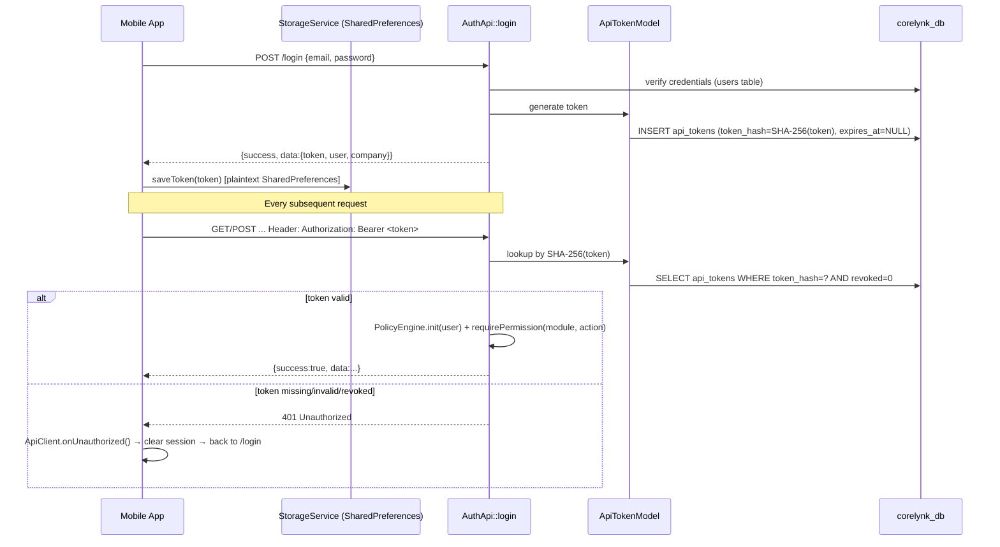
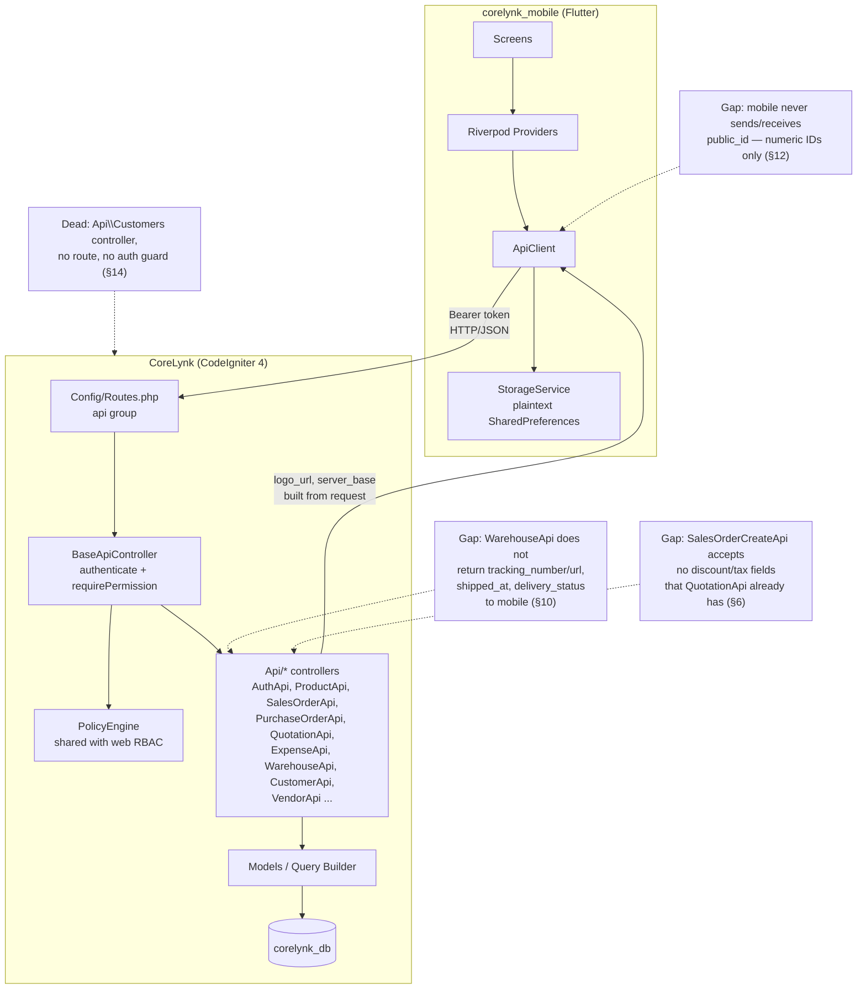

# CoreLynk Mobile Compatibility Audit

**Scope:** Read-only compatibility audit of `corelynk_mobile/` (Flutter) against the
current CoreLynk CodeIgniter 4 backend, `corelynk_db` MySQL schema, and mobile-related
settings. No application code, mobile code, database schema, or settings were modified
while producing this report.

**Method:** Direct reading of every mobile Dart source file that talks to the network
(`lib/api/*`, all `providers/*.dart`, all `screens/*.dart` that call `ApiClient`),
every backend `Api/*` controller reachable from the `api` route group, `Config/Routes.php`,
`Config/Filters.php`, `Controllers/Settings.php`, `Controllers/MobileAdmin.php`,
`Traits/PublicIdTrait.php`, `Libraries/PolicyEngine.php`, plus live `SHOW COLUMNS`/`SELECT`
queries against the running `corelynk_db` database (not just migration files) for every
mobile-relevant table.

---

## 1. Executive Summary

`corelynk_mobile` is a genuinely functional Flutter MVP wired to the real CoreLynk
backend via a bearer-token API layer — **not** a mock/prototype, despite its own
`README.md` claiming otherwise (see §15). Login, dashboard, products, sales orders,
purchase orders, quotations, expenses, and warehouse/delivery-order screens all make
real HTTP calls to `app/Controllers/Api/*` controllers and render real data.

The app is compatible with the current backend for its core flows. The gaps found are
narrow and specific, not systemic:

- Six `Endpoints` constants (`/user`, `/forgot-password`, `/reset-password`,
  `/dashboard/stats`, `/dashboard/activity`, `/projects`) have no backend route and are
  never actually called by any mobile screen — dead constants, not live breakage.
- The mobile app never uses `public_id` — it exclusively uses raw numeric IDs, which
  still works today (every mobile-facing API accepts numeric IDs) but diverges from the
  UUID `public_id` pattern used pervasively (63 files) on the web side.
- The mobile Warehouse screen does not surface delivery-order shipping/tracking fields
  (`tracking_number`, `tracking_url`, `shipped_at`, `delivery_status`,
  `estimated_delivery_days`, parcel images) that already exist on the live
  `delivery_orders` table and are already returned in parts by `WarehouseApi`.
- One dead, unauthenticated controller (`App\Controllers\Api\Customers`) sits in the
  `Api` namespace but is not wired to any route — currently harmless, but a latent risk
  if anyone adds a route to it without adding auth.
- No P0 blockers were found: nothing in the current backend actively breaks a flow the
  mobile app depends on today.

## 2. Mobile App Architecture

- **Framework:** Flutter, state management via Riverpod 2 (`Notifier`/`FutureProvider`,
  code-gen-free hand-written providers — no `.g.dart` files were found in scope).
- **Routing:** `go_router` (`lib/routes/app_router.dart`), single `GoRouter` instance,
  auth-gated `redirect` callback driven by `authNotifierProvider`.
- **Networking:** `package:http` wrapped by a hand-rolled `ApiClient`
  (`lib/api/api_client.dart`) — no Dio, no retrofit/chopper codegen.
- **Local storage:** `shared_preferences` via `StorageService` (`lib/core/storage/storage_service.dart`)
  — plaintext key/value, no `flutter_secure_storage`.
- **PDF:** `pdf` + `printing` packages, hand-built generator
  (`lib/shared/utils/pdf_generator.dart`) that explicitly mirrors the web's
  `invoice_system.php` template colours/layout.
- **No code generation, no GraphQL, no websockets** — a plain REST/JSON client app.

## 3. Mobile Module Inventory

Screens registered in `lib/routes/app_router.dart`:

| Route | Screen | Backend module |
|---|---|---|
| `/login` | `LoginScreen` | Auth |
| `/dashboard` | `DashboardScreen` | Owner dashboard |
| `/products`, `/products/:id` | `ProductsScreen`, `ProductDetailScreen` | Products |
| `/sales-orders`, `/sales-orders/:id` | `SalesOrdersScreen`, `SalesOrderDetailScreen` | Sales |
| `/purchase-orders`, `/purchase-orders/:id` | `PurchaseOrdersScreen`, `PurchaseOrderDetailScreen` | Purchases |
| `/create-so` | `CreateSalesOrderScreen` | Sales |
| `/create-po` | `CreatePurchaseOrderScreen` | Purchases |
| `/quotations`, `/quotations/:id` | `QuotationsScreen`, `QuotationDetailScreen` | Quotations |
| `/create-quotation` | `CreateQuotationScreen` | Quotations |
| `/expenses` | `ExpensesScreen` | Finance (journal-based) |
| `/warehouse` | `WarehouseScreen` | Warehouse / delivery orders |

There is also a `StockScreen` (`lib/features/products/screens/stock_screen.dart`) that
is **not registered in `app_router.dart`** — it exists in the codebase but has no route
and is unreachable via navigation as currently wired.

**Modules from the CLAUDE.md module list with no mobile presence at all:** Customer
create/edit (mobile only reads customers for dropdowns, never creates/edits one),
Vendors (read-only dropdown use only), Inventory beyond product stock counts, Production
(Work Orders / Process Batches — no mobile screens; also confirmed empty in the live DB,
0 rows in `work_orders` and `process_batches`), HR/Employees, full Finance (only
`receivables`/`payables` GET endpoints exist server-side and are unused by mobile;
`FinanceApi` is not called anywhere in `lib/`).

## 4. Mobile API Inventory

Every network call actually issued by the mobile app (grepped exhaustively across
`lib/**/*.dart` for `api.get/post/put/delete(Endpoints...)` plus the two hand-rolled
`http.get` calls):

| Method | Endpoint | Caller |
|---|---|---|
| POST | `/login` | `auth_provider.dart` |
| POST | `/logout` | `auth_provider.dart` |
| GET | `/company-info` | `auth_provider.dart` (`_refreshCompanyInfo`), `pdf_company_helper.dart` (raw `http.get`) |
| GET | `/owner/summary` | `dashboard_provider.dart` |
| GET | `/sales-orders` (+`latest=1`/`per_page`) | `dashboard_provider.dart`, `orders_provider.dart` |
| GET | `/sales-orders/{id}` | `orders_provider.dart` |
| POST | `/sales-orders` | `create_sales_order_screen.dart` |
| GET | `/purchase-orders` (+`latest=1`/`per_page`) | `dashboard_provider.dart`, `orders_provider.dart` |
| GET | `/purchase-orders/{id}` | `orders_provider.dart` |
| POST | `/purchase-orders` | `create_purchase_order_screen.dart` |
| GET | `/quotations` (+`per_page`) | `create_providers.dart` |
| GET | `/quotations/{id}` | `create_providers.dart` |
| POST | `/quotations` | `create_quotation_screen.dart` |
| GET | `/expenses` (+`per_page`) | `create_providers.dart` |
| POST | `/expenses` | `expenses_screen.dart` |
| GET | `/expense-accounts` | `create_providers.dart` |
| GET | `/payment-accounts` | `create_providers.dart` |
| GET | `/products` (+`per_page`, `include_variants`) | `products_provider.dart`, `create_providers.dart`, `stock_screen.dart` |
| GET | `/products/{id}` | `products_provider.dart` |
| GET | `/customers` (+`per_page=1000`) | `create_providers.dart` |
| GET | `/vendors` (+`per_page=1000`) | `create_providers.dart` |
| GET | `/warehouse/delivery-orders` | `orders_provider.dart` |
| GET | `/warehouse/ready-to-ship` | `orders_provider.dart` |

**Defined in `Endpoints` but never called anywhere in `lib/`** (confirmed by an
exhaustive grep of every `Endpoints.*` symbol against every `.dart` file):
`me`/`updateProfile` (`/user`), `forgotPassword`, `resetPassword`, `dashboardStats`,
`dashboardActivity`, `projects`. These are unused constants — see §18 for whether they
should be implemented or removed.

## 5. Current CoreLynk API Mapping

Full mobile-facing `api` route group (`app/Config/Routes.php:30-108`), namespace
`App\Controllers\Api`:

```
POST   login                          AuthApi::login
POST   logout                         AuthApi::logout
GET    company-info                   CompanyInfoApi::show
GET    dashboard                      DashboardApi::index        (legacy, unused by mobile)
GET    owner/summary                  OwnerDashboardApi::summary
GET    products                       ProductApi::index
GET    products/(:segment)            ProductApi::show/$1
GET    vendors                        VendorApi::index
GET    vendors/(:segment)             VendorApi::show/$1
GET    sales-orders                   SalesOrderApi::index
GET    sales-orders/(:segment)        SalesOrderApi::show/$1
POST   sales-orders                   SalesOrderCreateApi::create
GET    purchase-orders                PurchaseOrderApi::index
GET    purchase-orders/(:segment)     PurchaseOrderApi::show/$1
POST   purchase-orders                PurchaseOrderCreateApi::create
GET    quotations                     QuotationApi::index
GET    quotations/(:segment)          QuotationApi::show/$1
POST   quotations                     QuotationApi::create
GET    expenses                       ExpenseApi::index
POST   expenses                       ExpenseApi::create
GET    expense-accounts               ExpenseApi::expenseAccounts
GET    payment-accounts               ExpenseApi::paymentAccounts
GET    receivables                    FinanceApi::receivables    (unused by mobile)
GET    payables                       FinanceApi::payables       (unused by mobile)
GET    customers                      CustomerApi::index
GET    customers/(:segment)           CustomerApi::show/$1
GET    tags                           TagApi::index               (unused by mobile)
GET    tags/(:num)                    TagApi::show/$1              (unused by mobile)
POST   tags                           TagApi::create               (unused by mobile)
POST   tags/(:num)                    TagApi::update/$1             (unused by mobile)
DELETE tags/(:num)                    TagApi::delete/$1             (unused by mobile)
GET    document-tags                  DocumentTagsApi::index       (unused by mobile)
POST   document-tags                  DocumentTagsApi::save        (unused by mobile)
DELETE document-tags                  DocumentTagsApi::delete      (unused by mobile)
GET    admin/api-tokens               ApiAdminApi::tokens          (unused by mobile — web-admin only)
GET    admin/api-stats                ApiAdminApi::stats           (unused by mobile — web-admin only)
POST   admin/api-tokens/(:num)/revoke ApiAdminApi::revokeToken/$1  (unused by mobile — web-admin only)
GET    warehouse/delivery-orders      WarehouseApi::deliveryOrders
GET    warehouse/delivery-orders/(:num) WarehouseApi::showDeliveryOrder/$1  (unused by mobile — no detail screen calls it)
GET    warehouse/ready-to-ship        WarehouseApi::readyToShip
GET    admin/users                    MobileUserApi::index         (unused by mobile — web-admin only)
GET    admin/users/(:num)             MobileUserApi::show/$1       (unused by mobile — web-admin only)
POST   admin/users/(:num)/toggle-active MobileUserApi::toggleActive/$1 (unused by mobile — web-admin only)
POST   admin/users/(:num)/reset-password MobileUserApi::resetPassword/$1 (unused by mobile — web-admin only)
POST   admin/users/(:num)/set-role    MobileUserApi::setRole/$1    (unused by mobile — web-admin only)
GET    admin/roles                    MobileUserApi::roles         (unused by mobile — web-admin only)
```

`Endpoints` constants with **no route at all** in the `api` group: `/user`,
`/forgot-password`, `/reset-password`, `/dashboard/stats`, `/dashboard/activity`,
`/projects`.

## 6. API Contract Differences

- **Envelope key inconsistency for lists.** `BaseApiController::success()` wraps every
  response as `{success, data, message}`, but the shape of `data` for list endpoints is
  not uniform:
  - `CustomerApi::index`, `SalesOrderApi::index`, `PurchaseOrderApi::index`,
    `ExpenseApi::index` return `data.data` (CI4 pager array shape: `{data:[...], pager:{...}}`).
  - `ProductApi::index`, `VendorApi::index`, `QuotationApi::index`,
    `WarehouseApi::deliveryOrders`/`readyToShip` return `data.items`.
  - Mobile compensates for this defensively everywhere — every provider does
    `data['items'] ?? data['data'] ?? []` — so it currently works, but it is a real
    server-side inconsistency, not an intentional contract.
- **Sales order create payload is thinner than quotation create.** `QuotationApi::create`
  accepts and persists `discount_type`, `discount_value`, `tax_rate`, `unit` per line
  (matching `sales_order_lines`/`quotation_line` schema columns that support them).
  `create_sales_order_screen.dart`'s POST body only sends `product_id`, `description`,
  `quantity`/`qty`, `unit_price` — no discount/tax fields — so sales orders created from
  mobile always land with `discount_amount=0`, `tax_rate=0` (column defaults). Not a
  breaking bug (columns are nullable/defaulted), but a functional gap versus quotations.
- **`mobile_api_url` system setting is never consumed by the API layer.** It is set via
  `Settings::saveMobileSettings()` and displayed back via `Settings::index()`
  (`app/Controllers/Settings.php:85-96, 1016-1047`), stored in `system_settings`, but
  no `Api/*` controller or `BaseApiController::serverBaseUrl()` ever reads it — confirmed
  live: the `system_settings` row for `mobile_api_url` does not currently exist. It is
  effectively a documentation-only field for admins, not a value the mobile app or API
  layer consumes.

## 7. Authentication Compatibility

`AuthApi::login`/`logout` (`app/Controllers/Api/AuthApi.php`) use a bearer-token scheme
backed by `ApiTokenModel` (`app/Models/ApiTokenModel.php`), completely independent of
the web's session-based `Auth` filter. `api`/`api/*` are excluded from both the global
`auth` and `rbac` filters (`app/Config/Filters.php:60-110`); every `Api/*` controller
self-authenticates via `BaseApiController::authenticate()` and gates individual actions
via `BaseApiController::requirePermission($module, $action)`, which delegates to the
same `PolicyEngine` (`app/Libraries/PolicyEngine.php`) the web app uses — so RBAC rules
are shared, not duplicated, between web and mobile.

Live DB check: `api_tokens.expires_at` is `NULL` for all 36 currently active tokens —
confirms `ApiTokenModel`'s default `$ttlDays = 0` (never expire) is what's actually in
effect on this instance, not just a code default that's overridden elsewhere.



## 8. CoreLynk Mobile Settings

`Settings::saveMobileSettings()` (`app/Controllers/Settings.php:1016-1047`) validates
and persists a single field, `mobile_api_url`, to the `system_settings` key/value table
(read back at `Settings::index()` lines 85-96 and rendered in
`app/Views/settings/index.php:1635-1636`). This is the **only** mobile-specific setting
in the backend.

**Finding: this setting is decorative.** Grepped for every reference to
`mobile_api_url` in `app/` — it is written and read only within `Settings.php`/its view.
No `Api/*` controller, `BaseApiController`, or `MobileAdmin.php` ever reads it.
`BaseApiController::serverBaseUrl()` derives the server base dynamically from
`$_SERVER['SCRIPT_NAME']`/`HTTP_HOST` on every request instead. Live DB check confirms
no `mobile_api_url` row currently exists in `system_settings` on this instance. The
mobile app's actual server URL is configured client-side only: a hardcoded default in
`lib/api/endpoints.dart` (`http://192.168.100.110/corelynk/public/api`), optionally
overridden per-device at login time via a "Server Configuration" dialog
(`lib/features/auth/screens/login_screen.dart`) that writes to
`StorageService.saveServerUrl()`. The two settings surfaces (backend admin field, mobile
login-screen dialog) are not connected to each other.

`MobileAdmin.php` (`app/Controllers/MobileAdmin.php`) is a separate, session-based web
admin panel for managing mobile users and API tokens — not a source of runtime mobile
config either. Its "disable mobile access" action for a user actually sets
`users.is_active = 0`, which also blocks that user's **web** login — there is no
mobile-only access flag independent of full account status.

## 9. Module Compatibility Matrix

| Module | Mobile screens | Backend API | Status |
|---|---|---|---|
| Auth | Login/logout | `AuthApi` | ✅ Compatible |
| Dashboard | `DashboardScreen` | `OwnerDashboardApi::summary` | ✅ Compatible |
| Products | List/detail | `ProductApi` | ✅ Compatible (variants + inventory + locations) |
| Sales Orders | List/detail/create | `SalesOrderApi`, `SalesOrderCreateApi` | ✅ Compatible; create payload thinner than backend schema supports (§6) |
| Purchase Orders | List/detail/create | `PurchaseOrderApi`, `PurchaseOrderCreateApi` | ✅ Compatible |
| Quotations | List/detail/create | `QuotationApi` | ✅ Compatible, richest line-item schema of the three |
| Expenses | List/create | `ExpenseApi` | ✅ Compatible (journal-entry backed) |
| Warehouse/Delivery | Ready-to-ship + DO list | `WarehouseApi` | ⚠️ Partial — newer shipping/tracking columns exist server-side and are not surfaced (§13/§17) |
| Customers | Dropdown only (read) | `CustomerApi` | ⚠️ Partial — no create/edit in mobile |
| Vendors | Dropdown only (read) | `VendorApi` | ⚠️ Partial — no create/edit in mobile |
| Finance (AR/AP) | None | `FinanceApi` | ❌ Not implemented in mobile |
| Tags/Document Tags | None | `TagApi`, `DocumentTagsApi` | ❌ Not implemented in mobile |
| Admin (users/tokens) | None (by design — web-admin only) | `MobileUserApi`, `ApiAdminApi` | N/A |
| Inventory (beyond stock count) | None | — | ❌ Not implemented in mobile |
| Production (Work Orders) | None | — | ❌ Not implemented; also 0 live rows in `work_orders`/`process_batches` |
| HR | None | — | ❌ Not implemented in mobile |

## 10. Database/Data Model Differences

Live schema (`SHOW COLUMNS`, run directly against `corelynk_db`) vs. what mobile models consume:

- **`delivery_orders`** has `tracking_number`, `tracking_url`, `shipped_at`,
  `delivery_status`, `delivery_confirmed_at`, `delivery_notes`, `estimated_delivery_days`,
  `parcel_image`, `delivery_screenshot`, `shipping_vendor_id`, `shipping_service_id`,
  `final_weight_kg`, `shipping_cost_pkr` — none of these are read by
  `warehouse_screen.dart`/`orders_provider.dart`, and most are not even selected by
  `WarehouseApi::deliveryOrders()`'s SQL (`app/Controllers/Api/WarehouseApi.php:41-43`
  selects only `do.id, do.do_number, do.status, do.created_at, do.updated_at` plus joined
  SO fields). `WarehouseApi::readyToShip()` does reference `do.shipped_at`/
  `do.tracking_number` server-side (lines 163-164) but only to compute a derived
  `ship_status` label — the raw tracking number/URL/notes are never returned to mobile.
- **`sales_orders`/`purchase_orders`/`quotations` line tables** all carry
  `discount_type`/`discount_value`/`discount_amount`/`tax_rate`/`tax_amount`/`sort_order`
  /`section_title`/`display_type` columns that only `QuotationApi` fully exposes and
  accepts; `SalesOrderCreateApi`/`PurchaseOrderCreateApi` write plain qty×price lines
  only (§6).
- **`api_tokens`** live schema: `id, user_id, token_hash, name, expires_at, last_used_at,
  revoked, created_at, updated_at`. Matches `ApiTokenModel` usage exactly — no drift.
- **Every mobile-relevant table now has a `public_id char(36) UNIQUE` column**
  (`delivery_orders`, `sales_orders`, `purchase_orders`, `customers`, `vendors`,
  `products`, `vendor_bills` all confirmed live) — mobile never uses it (§12).
- **Production module tables exist but are empty**: live `SELECT COUNT(*)` returned `0`
  rows for both `work_orders` and `process_batches` — confirms production is not an
  active workflow on this instance today, independent of mobile coverage.
- No table mobile depends on is missing, renamed, or has a dropped column relative to
  what the API controllers/mobile models expect — schema drift is not the source of any
  compatibility gap found in this audit.

## 11. Status/Enum Differences

- `sales_orders.status` is a real MySQL `ENUM('draft','confirmed','shipped','closed')`.
  `purchase_orders.status` and `delivery_orders.status` are plain `varchar`, not
  DB-enforced enums — their valid values are whatever the PHP application code writes
  (`draft`, `ready`, `confirmed`, `shipped`, `delivered`, `cancelled`, `closed` observed
  in `WarehouseApi.php`'s SQL).
- Mobile's generic status-chip widgets use case-insensitive string matching, not a fixed
  enum. In `sales_order_detail_screen.dart`'s `_StatusChip` (lines 401-407): green for
  `completed|paid|delivered|received`, yellow for `pending|draft`, red for
  `cancelled|rejected|closed`, blue for `confirmed|processing|approved`, grey (default)
  for anything else. **`'shipped'` — a real, reachable `sales_orders.status` enum
  value — is not in any of the matched buckets**, so a shipped sales order renders with
  the default grey/unstyled chip instead of a meaningful color. Cosmetic only; the label
  text itself still displays correctly.
- `delivery_orders` additionally has a separate `delivery_status varchar(30)` column
  (distinct from `status`) that is never read by mobile at all (§10).

## 12. Public ID/Identifier Differences

`PublicIdTrait` (`app/Traits/PublicIdTrait.php`) provides UUID v4 `public_id` generation
on insert (`bootPublicId()`/`generatePublicId()`) and dual-mode lookup
(`findByPublicIdOrId()` — accepts either a numeric ID or a public_id string) plus a
`backfillPublicIds()` CLI helper. It is used by 63 files across the web codebase (Models
and Controllers) as the standard external identifier to prevent numeric ID enumeration.

**Every mobile-facing `Api/*` controller and every mobile Dart file uses raw numeric
`id` exclusively** — none reference `public_id`, and none of the mobile-facing routes
use `findByPublicIdOrId()`. This is not a breaking incompatibility today (numeric IDs
still resolve correctly everywhere mobile uses them), but it is an architectural
divergence: the mobile API surface is the one part of the application still exposing
sequential numeric IDs externally, which is exactly the enumeration risk `PublicIdTrait`
was introduced to close on the web side.

## 13. File/Image/PDF Compatibility

- **Company logo / assets:** `CompanyInfoApi::show` and the login response build a full,
  absolute `logo_url` server-side (via `BaseApiController::serverBaseUrl()`, derived
  per-request from `HTTP_HOST`/`SCRIPT_NAME`) so the mobile app never has to construct
  asset URLs itself — this is deliberately robust to server base changes and works
  correctly regardless of which LAN IP is configured.
- **PDF generation is entirely client-side.** `lib/shared/utils/pdf_generator.dart`
  hand-builds PDFs with the `pdf`/`printing` packages, explicitly commented as mirroring
  `invoice_system.php`'s CSS palette/layout — this is a parallel implementation, not a
  shared template, so any future change to the web PDF/invoice template will silently
  diverge from the mobile PDF unless someone manually updates both.
- `PdfCompanyHelper` (`lib/shared/utils/pdf_company_helper.dart`) always attempts a live
  `GET /api/company-info` fetch before generating a PDF, falling back to cached
  `SharedPreferences` values on failure — network failures are silently swallowed
  (`on SocketException`, generic `catch (_)`), so a stale/incorrect cached logo could be
  used indefinitely without any user-visible warning if the network call keeps failing.
- No mobile screen uploads images/files to the backend — `parcel_image`,
  `delivery_screenshot`, product `images` are all read-only concerns server-side that
  mobile doesn't touch either way (consistent with §10's finding that mobile doesn't
  consume them at all).

## 14. Security Findings

1. **Plaintext local token storage.** `StorageService` persists the bearer token, user
   id/email/name, and company info via unencrypted `SharedPreferences`
   (`lib/core/storage/storage_service.dart`) — no `flutter_secure_storage`/keychain use.
   Combined with tokens that never expire (§7), a compromised/rooted device yields a
   permanently valid credential.
2. **Dead, unauthenticated controller in the `Api` namespace.**
   `app/Controllers/Api/Customers.php` extends `BaseController` directly (not
   `BaseApiController`) and has no `authenticate()`/`requirePermission()` calls
   anywhere in `index()`, `show()`, `create()`, `update()`, or `delete()` — if any route
   were ever added pointing to it, it would expose full customer CRUD (including
   PII) with zero authentication. Confirmed via `Config/Routes.php` that no route
   currently targets `Api\Customers` — it is unreachable today, but it is a live landmine
   sitting in a directory whose sibling files are all auth-gated.
3. **CSRF is globally disabled, not just exempted for the API.** `Config/Filters.php`
   has the `csrf` filter commented out of `globals['before']` entirely — this is a
   site-wide condition, not something introduced by or specific to mobile, but it means
   the web session-based forms (including the mobile-settings form in §8) currently have
   no CSRF protection either.
4. **API tokens never expire by default** (§7) — `ApiTokenModel`'s `$ttlDays = 0`, and
   live data confirms this is the actual behavior in production (`expires_at IS NULL` for
   all 36 active tokens).
5. **"Disable mobile access" conflates with full account disable** (§8) — an admin
   trying to revoke only mobile access via `MobileAdmin.php` will also lock the user out
   of the web app, since both check the same `users.is_active` flag.
6. Two independently-maintained, hardcoded `exposedApis` documentation lists exist —
   one in `ApiAdminApi::stats()`, one in `MobileAdmin::getExposedApis()` — and both are
   stale relative to the real route table (both omit `/api/tags` and
   `/api/document-tags`; `MobileAdmin`'s list additionally references a non-existent
   `/api/user`). Not a security hole by itself, but it means anyone auditing "what APIs
   are exposed" from either admin screen gets an incomplete/inaccurate picture.

## 15. Dependency/Build Findings

- `pubspec.yaml` dependencies are all mainstream, actively maintained packages
  (`flutter_riverpod`, `go_router`, `http`, `shared_preferences`, `pdf`, `printing`,
  `path_provider`, `intl`) — nothing exotic, nothing abandoned, nothing that looks like
  a supply-chain risk from names/versions alone.
- **`README.md` is stale and actively misleading.** It states the API client is "not
  connected to a real backend" — false; `ApiClient`/every provider in this audit makes
  real, working HTTP calls to the live backend. Its documented folder structure also
  omits the `create/`, `orders/`, and `products/` feature directories that exist and are
  wired into the router. Anyone onboarding from the README alone would materially
  misunderstand the app's actual state.
- `lib/api/endpoints.dart` hardcodes a LAN IP (`192.168.100.110`) as the compile-time
  default `baseUrl`, with unused `stagingUrl`/`productionUrl` constants defined but never
  referenced anywhere — no environment-based build flavor wiring exists. This default is
  overridable per-device at runtime via the login screen's "Server Configuration" dialog
  (§8), which mitigates but does not eliminate the risk of a fresh install pointing at a
  address that isn't reachable off that specific LAN.
- `StockScreen` exists in source but is not registered in `app_router.dart` — dead/
  unreachable code, not a build error, but worth flagging as orphaned.

## 16. Confirmed Working Features

All verified by direct code tracing from mobile screen → provider → `ApiClient` call →
matching, currently-routed backend controller method → live-verified table/columns:

- Login/logout with token persistence and 401 auto-logout.
- Dashboard financial summary (`OwnerDashboardApi::summary`).
- Product list + detail with variants, per-location inventory, stock quantities.
- Sales order list, detail, and creation.
- Purchase order list, detail, and creation.
- Quotation list, detail, and creation (richest line-item contract of the three).
- Expense recording via journal entries (field names match `ExpenseApi::create` exactly).
- Warehouse "ready to ship" and delivery-order list views.
- Company info fetch + PDF generation using live-derived logo URLs.
- RBAC permission checks (shared `PolicyEngine` with the web app — not a parallel/
  divergent permission system).

## 17. Confirmed Broken/Outdated Features

None of the flows the mobile app currently exercises are broken against the live
backend/database as verified in this audit — no P0s. The items below are **outdated/
incomplete relative to what the backend now supports**, not currently-broken:

- Warehouse screen does not read any of the shipping/tracking columns that already exist
  on `delivery_orders` (§10, §13) — the UI is behind the schema, not broken by it.
- Sales order creation doesn't use discount/tax fields that the schema and
  `QuotationApi` already support (§6).
- `'shipped'` status renders with no color styling in `_StatusChip` (§11) — cosmetic.

## 18. Missing Backend APIs

- `/user` (GET/PUT — read/update own profile): referenced by `Endpoints.me`/
  `updateProfile` in the mobile app but no route exists. Since nothing in `lib/`
  currently calls it, this is presently a no-op gap, not a broken feature — but if a
  future "edit profile" screen is added, the backend endpoint must be created first.
- `/forgot-password`, `/reset-password`: referenced by constants, never called, no route.
  No password-reset flow exists anywhere in the mobile UI to trigger them.
- `/dashboard/stats`, `/dashboard/activity`: superseded by `/owner/summary`, which is
  what the dashboard actually uses — these constants are vestigial.
- `/projects`: no backend concept of "projects" exists anywhere in the schema or route
  table (confirmed — no `projects` table in `corelynk_db`). Vestigial constant with no
  corresponding feature on either side.

## 19. Missing Mobile Features

- No create/edit for Customers or Vendors (read-only dropdowns only).
- No Finance/AR-AP screen despite `FinanceApi::receivables`/`payables` already existing
  and being ready to consume.
- No Tags/Document Tags UI despite a complete, routed `TagApi`/`DocumentTagsApi` backend.
- No delivery-order detail/tracking screen consuming `WarehouseApi::showDeliveryOrder`
  (routed, but nothing in mobile calls it) or the newer shipping columns (§10).
- No Production/Work Order visibility (though this is currently a non-issue in practice
  since the live tables are empty — §10).
- No admin/user-management mobile UI (by design — `MobileUserApi`/`ApiAdminApi` are
  intended for the web admin panel per `MobileAdmin.php`, not mobile itself).

## 20. Recommended Integration Architecture

No architectural change is required to restore compatibility — the existing bearer-token
REST pattern already works end-to-end. The diagram below reflects the current, still-valid
architecture with the specific gaps from this audit annotated, for use as a remediation
map rather than a redesign:



## 21. Fix Priority (P0–P3)

**P0 (blocking):** None found. No currently-used mobile flow is broken against the
current backend/database.

**P1 (should fix soon — security/data-integrity relevant):**
- Remove or route-and-secure `App\Controllers\Api\Customers.php` (§14.2) — dead code
  with zero auth is a landmine, not an active exploit, but should not remain as-is.
- Set a sane default token TTL in `ApiTokenModel` / issue tokens with `expires_at` set
  (§7, §14.4) instead of the current never-expire default.
- Separate "disable mobile access" from `users.is_active` in `MobileAdmin.php` (§8,
  §14.5) so revoking mobile access doesn't also lock out web login.

**P2 (functional gaps worth closing):**
- Add discount/tax fields to `SalesOrderCreateApi`/`create_sales_order_screen.dart` to
  match `QuotationApi`'s contract (§6).
- Surface `tracking_number`, `tracking_url`, `shipped_at`, `delivery_status` in
  `WarehouseApi` responses and the Warehouse screen UI (§10, §13).
- Add `'shipped'` (and `'ready'`, `'delivered'`) to the mobile status-chip color mapping
  (§11).
- Reconcile the two divergent `exposedApis` documentation lists, or generate one from
  the actual route table (§14.6).

**P3 (cleanup, no functional impact):**
- Remove unused `Endpoints` constants (`me`, `updateProfile`, `forgotPassword`,
  `resetPassword`, `dashboardStats`, `dashboardActivity`, `projects`) or implement the
  backend routes if profile-edit/password-reset are actually planned (§18).
- Fix or remove the stale `corelynk_mobile/README.md` (§15).
- Either register `StockScreen` in `app_router.dart` or delete it (§15).
- Standardize the `data.items` vs `data.data` list envelope across `Api/*` controllers
  (§6) so mobile providers don't need defensive dual-key lookups.
- Remove the decorative `mobile_api_url` setting or actually wire it into
  `BaseApiController::serverBaseUrl()`/mobile's default endpoint resolution (§8).

## 22. Phased Remediation Plan

1. **Phase A — Security hygiene (P1 items).** Remove/secure `Api\Customers`, add token
   expiry, decouple mobile-access toggle from `is_active`. No mobile app changes
   required for the first two; the third is backend-only.
2. **Phase B — Contract parity (P2 items).** Extend `SalesOrderCreateApi` to accept the
   same line-item fields `QuotationApi` already accepts; extend `WarehouseApi` to return
   the tracking/shipping fields; update the Warehouse screen and status-chip widgets to
   consume them. Ship backend and mobile changes together since this phase changes the
   wire contract both directions.
3. **Phase C — Documentation/cleanup (P3 items).** Remove dead `Endpoints` constants or
   implement their routes (decide per-constant), fix the mobile README, resolve
   `StockScreen`, standardize list envelopes, resolve the `mobile_api_url` setting's fate.
4. **Phase D — Feature completion (§19, optional/product-decision-gated).** Customer/
   vendor create-edit, Finance AR/AP screen, Tags UI, delivery-order detail screen —
   only pursue if these are genuinely wanted on mobile; none are compatibility
   requirements.

## 23. Regression Test Matrix

| Area | Test | Expected result after any remediation phase |
|---|---|---|
| Auth | Login with valid/invalid credentials | Valid → token stored, dashboard loads; invalid → error shown, no token stored |
| Auth | 401 mid-session (revoke token server-side, then make any call) | Mobile auto-clears session and redirects to login |
| Dashboard | Load `/dashboard` after login | Financial summary renders without error even with zero data |
| Products | Open a variable product's detail screen | Variants + per-location inventory render correctly |
| Sales Orders | Create SO with 1+ lines, view it in detail | Order appears in list, detail shows correct totals; after Phase B, discount/tax fields persist |
| Purchase Orders | Create PO with 1+ lines, view it in detail | Same as above for POs |
| Quotations | Create quotation with discount+tax on a line | Totals match server-computed totals |
| Expenses | Record an expense against an expense/payment account pair | Journal entry created; entry appears in expense list |
| Warehouse | Load ready-to-ship and delivery-order tabs | Lists render; after Phase B, tracking/shipped info visible where present |
| Status chips | View a sales order with `status='shipped'` | After P2 fix: renders with a distinct, non-default color |
| Security | Attempt to hit any `Api\Customers` (if ever routed) unauthenticated | Must be rejected (401) after Phase A remediation |
| Security | Inspect an issued token's `expires_at` after Phase A | Must be non-null and enforced |
| Settings | Set `mobile_api_url` in web admin, then check if it affects the mobile app | Currently: no effect (confirms §8 finding) — verify intended behavior post-Phase-C |

## 24. Final Recommendation

Do not treat this as an emergency remediation — there is no P0. The mobile app already
works against the current backend for every flow it implements. The highest-value next
steps are the three P1 security items (§21), which are backend-only and low-risk to
ship independently of any mobile release. Contract-parity work (Phase B) is the only
phase that requires a coordinated mobile+backend release, and should be scoped as a
deliberate feature decision (does the team actually want mobile SO creation to support
discounts, and mobile warehouse to show tracking info?) rather than treated as a bug fix.

---

*Audit conducted read-only; no files outside this report were created or modified.*
